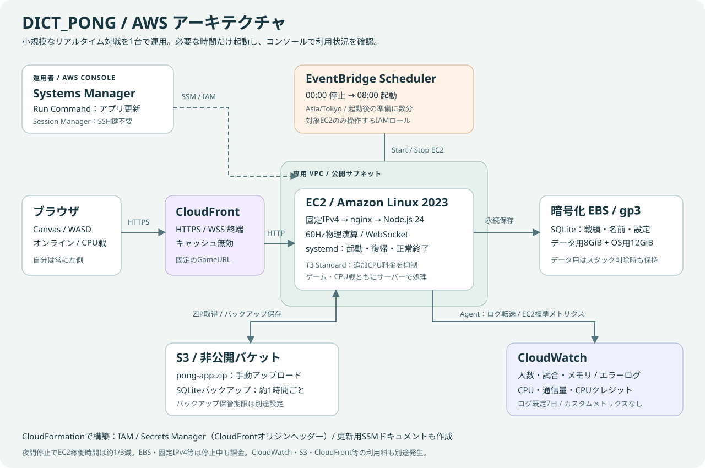

# 実装と検証

単体図：[architecture.svg](architecture.svg)。配布キットでは `ARCHITECTURE.svg` として同梱します。

## サーバー

Node.js 24 LTSと `ws` でHTTP/WebSocketを同じポートに提供します。画面・API・WebSocketは同じオリジンです。サーバーで60Hzの固定ステップ計算を行い、最大60Hzで状態を送ります。クライアントからは操作のみ受け付け、ボール位置・得点・勝敗の申告は受け付けません。

ホームでマウス（既定）／WASDを選択し、ブラウザーに保存します。マウスはホバー追従、タッチはドラッグです。最初の入力を即時送信し、以降の位置更新を最大60Hzにまとめ、100msごとに保持中の入力を更新します。相手と球は受信状態を補間し、自分のバーは余分な補間をしません。

マウス選択中は `public/movement.js` のサーバーと共通の移動計算で自分のマレットを毎フレーム、カーソル位置へ直接動かします。マウスの追従速度制限と補間はありません。サーバー返信が遅れても移動を描画し、自陣と外周の範囲制限を維持します。WASDとCPUの速度制限は維持します。ゴール時はサーバーのリセット位置を反映し、操作解除時は確定状態に戻ります。球の予測・衝突のロールバック同期はありません。通信遅延が大きい場合、表示とサーバーの衝突判定に一時的な差が出ます。体感遅延の実測は未実施です。

暗いネイビーと水色のダークモードで、ホーム・対戦・戦績・管理を別のviewに分けます。ホームにCanvasを含めず、待機中もホームに留まります。サーバーからmatchを受信すると対戦viewへ遷移し、描画ループを開始します。対戦終了後は結果を表示し、ホームへ戻ると描画ループを停止します。プレイ画面はウィンドウの高さに合わせたFlex配置で、Canvasは縦横比を保って収めます。ゴールは物理演算と共有する寸法に従い、12pxの枠・ネット模様・GOALの文字で強調します。主な操作文字は16px以上とします。降参は確認ダイアログを経て既存のleaveプロトコルで送信し、サーバーがforfeitとして敗北を記録します。要求の連打はクライアントでも抑制します。

コートは1200×640。マレットの半径は40、球の半径は12。左右のゴールは高さ196〜444の248ピクセル幅へ拡大しました（従来176px）。ゴール以外の側面は反射し、開口部の上下端は球の半径を考慮して反射します。球全体がゴールを抜けた時点で得点します。寸法は `public/field.js` をサーバーの物理演算と画面描画で共有します。

WASD選択時は、250ms以内の同方向の押し直しで8方向ダッシュを要求します。自動キーリピートは除外します。方向と一意の連番だけを送信し、サーバーが重複要求を除外し、60Hzステップで一度だけ消費します。スタミナ（最大100、消費35）、回復（0.65秒後から毎秒22）、ダッシュ時間0.13秒、速度1550、間隔0.23秒、移動範囲はサーバー側で判定します。斜めの速度と消費量は正規化して同じにします。右側の入力・ダッシュ方向・表示状態も反転します。

自陣内を四方向に移動し、円どうしの接触点・法線で反射します。高速時のすり抜けを避けるため、球を最大1/240秒、マレットの移動を最大20pxのサブステップで計算します。高速なマウス移動でも経路を補間して衝突を検出します。右側参加者は状態と操作を左右反転します。上下は反転しません。

マッチングキュー、プライベートルーム、接続一覧、進行中の試合はメモリ上です。複数Nodeプロセス・複数EC2へそのまま分散させる構成には対応しません。

## 保存

Node組み込みの `node:sqlite` を使います。Node 24系列の当該APIはリリース候補段階のため、配布時に検証した24.22.1に固定します。外部SQLiteドライバーのコンパイルは不要です。

テーブルは `players`、`sessions`、`matches`、`results`、`settings`。WALモードと外部キーを使用し、終了結果を1トランザクションで両者分保存します。管理設定もSQLiteに保存します。名前はNFC正規化と前後の空白除去を行い、大文字・小文字は区別します。

パスワードによる本人認証は行いません。初回参加時にランダムなセッションを生成し、HttpOnly・SameSite=StrictのCookieへ保存します。AWS上ではSecureも付けます。同じ名前で新しく参加すれば既存のプロフィールを利用できます。管理操作はセッションのプレイヤー名が `chun` かをサーバー側で確認します。

## AWS

AWSの通知用SNS・Budgets・アラームは作成しません。CloudWatchのログと利用状況ダッシュボードを残し、必要なときにコンソールで確認します。前の版からYAMLを更新すると、以前作った通知用リソースは削除されます。

`EnableAuditTrail=true` の場合だけ、東京などスタックのリージョンの管理イベントとグローバルサービスイベントを記録するCloudTrail証跡と専用の非公開S3バケットを作成します。SSE-S3、配信元証跡ARNの制限、HTTPS必須、30日ライフサイクルを設定します。バケットは削除・無効化時も保持します。KMS／RDS Data APIの管理イベント、データイベント、Insights、Lakeは対象外です。既存の証跡がある場合は重複課金を避けるため既定のfalseを維持します。

CloudFormationは専用VPC・公開サブネット・EC2 1台・固定IPv4・暗号化データEBS・CloudFrontを作成します。HTTPS/WSSはCloudFrontで終端し、EC2へはHTTPで転送します。EC2の80番は公開ですが、ヘルスチェック以外のアプリ要求は自動生成のオリジンヘッダーで拒否します。SSHは開けず、SSMで管理します。

CloudFrontはCachingDisabledとAllViewerの管理ポリシーを使用し、CookieとWebSocketのハンドシェイク情報を転送します。自動生成のオリジン用Secrets Managerシークレットはゲームの管理者判定とは無関係です。手動設定や入力は不要です。

初期設定ではNode公式バイナリのSHA-256を照合します。CloudFormationのWaitConditionは初期設定・マウント・起動・初回バックアップが成功した場合にだけ成功通知を受けます。AWS料金・残存EBS・バックアップの保管期限は設置手順書に記載しています。

EventBridge SchedulerからEC2のStartInstances / StopInstancesを直接呼び出し、Asia/Tokyoの0時停止・8時起動を設定します。Lambdaや別のスケジューラー用サーバーは使いません。実行ロールは対象のEC2 1台への開始・停止権限のみを持ちます。最大再試行期間は5分です。EC2稼働時間は約1/3減りますが、EBSと固定IPv4等は停止中も課金されます。T3は既定でStandardクレジットモードとし、超過課金を避ける代わりに残量不足時は性能を制限します。

アプリは構造化JSONで試合開始・終了・接続数を記録し、1分ごとに人数・試合数・RSSメモリを出力します。systemdの出力を `/var/log/pong/application.log` に保存し、CloudWatch Agentがnginxエラーとともに転送します。アプリイベントには名前・IP・セッションを含めません。ローカルログはlogrotate、CloudWatchは既定7日で保管量を抑えます。OSのCPU・通信量・クレジットはEC2標準メトリクスを利用し、追加カスタムメトリクスは発行しません。人数・試合のグラフはLogs Insightsで、クエリのスキャン量には料金が発生します。

既存スタックへのテンプレート更新ではUserDataは再実行されません。更新後のSSMドキュメントでアプリを更新し、監視用SSMドキュメントでログ設定を適用します。更新スクリプトは監視設定を含む起動確認に失敗した場合、前のコードへ戻します。データディスクは変更しません。

## 自動テスト

- 物理：左右反転、円周の四方向・斜めでの反射、接触中の再反射防止、移動範囲と斜め速度、8方向ダッシュ・消費・回復・残量不足・間隔・範囲制限、上下壁、拡大ゴールでの得点、ゴール端と球の半径、5点、すり抜け、CPU差分。
- 保存：名前の区別、セッション、再参加、勝率・得点・時間・相手別・モード別集計、中断の除外、設定と結果の永続化、トランザクションのロールバック。
- 通信：実HTTP/WebSocketで2人が接続し、ルーム対戦から5点決着まで操作。両者の左側操作、CPU3段階、ランダムマッチング、途中終了、管理停止、日時予約、毎日の時間制限、名前のみの管理権限、再起動、ログアウト。
- 画面：jsdomでJavaScriptを実行し、登録、CPU選択、対戦・結果・戦績表示、管理画面、設定保存、停止表示、操作方法選択・保存、マウス即時送信・サーバー応答前の移動描画・速度と範囲制限を確認。Canvas APIへの描画指示は確認しますが、実際のレイアウトと体感は検証しません。
- 配布：ZIPの必須ファイル、パス、秘密・実行データの混入がないこと、展開したZIPからの起動と通信を確認。
- AWS：CloudFormationを `cfn-lint` で静的検証し、Bashスクリプトを構文検証。

自動テストで丸いマレットの接触・直接追従・高速ストロークも確認しています。通信テストでは左右両者のダッシュと消費量・連番の再送拒否も確認し、画面テストでは長押し除外・斜めダブルタップ・フォーカス離脱・残量表示も確認しました。実AWSへのデプロイ・監査ログ保存・時刻指定の開始停止・CloudWatchへの送信、負荷試験は未実施です。ブラウザー連携が利用できず、代替の画面操作も承認待ちでタイムアウトしたため、表示・全画面・音・タッチと体感遅延の実機確認は未実施です。

## 運用範囲

200 WebSocket接続をアプリの上限としていますが、性能を保証する同時接続数ではありません。実測に基づく調整が必要です。プレイヤー一覧は新しい登録から最大1,000人、各人の履歴は直近30試合を表示し、全履歴はDBに保存します。記録の削除UIやランキング、観戦、切断後の途中復帰、他端末の強制ログアウトは実装範囲に含めていません。

API・WebSocketの頻度制限、JSONサイズ制限、同一オリジンの操作確認、HTMLエスケープ、CSPを設定しています。名前だけの管理者という仕様を、本人確認付きのアカウント制とはみなさないでください。

## 参照した公式資料

- [Node.js 24 SQLite API](https://nodejs.org/download/release/latest-v24.x/docs/api/sqlite.html)
- [CloudFrontのWebSocket](https://docs.aws.amazon.com/AmazonCloudFront/latest/DeveloperGuide/distribution-working-with.websockets.html)
- [CloudFrontの管理オリジンリクエストポリシー](https://docs.aws.amazon.com/AmazonCloudFront/latest/DeveloperGuide/using-managed-origin-request-policies.html)
- [CloudFormationのWaitCondition](https://docs.aws.amazon.com/AWSCloudFormation/latest/UserGuide/using-cfn-waitcondition.html)

詳しい追加検証と修正内容は [検証結果](TEST_REPORT.md) を参照してください。
